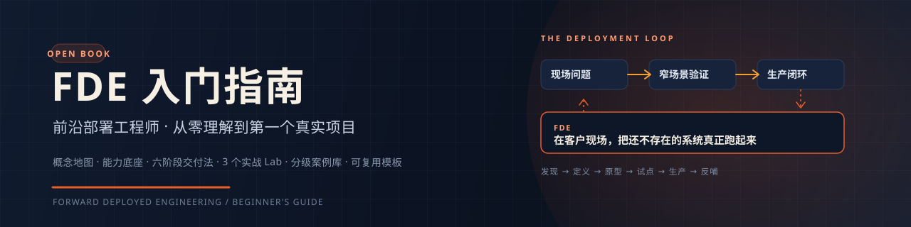

<p align="center">
  
</p>

<h1 align="center">FDE 入门指南</h1>

<p align="center">
  一份写给零基础读者的开源指南：从概念、能力地图、交付方法，到你的第一个真实项目。
</p>

<p align="center">
  <a href="https://sddzlsc.github.io/fde/"></a>
  <a href="LICENSE"></a>
  <a href="CONTRIBUTING.md"></a>
  
</p>

---

## 这是什么

**FDE（Forward Deployed Engineer，前沿部署工程师）**，是走进客户现场、把还不存在的 AI / 软件系统真正跑起来，并把现场经验反哺产品的人。

过去，这个角色主要存在于 Palantir 等少数公司。今天，OpenAI、Anthropic、Salesforce、Sierra、Decagon、Databricks，以及中国的火山引擎、安永等组织，都在大规模组建 FDE 团队。它正在从「一个冷门岗位」变成「AI 落地最关键的一公里」。

但市面上关于 FDE 的中文资料，要么是招聘 JD 的复述，要么是几个传奇故事的拼贴，很少有人回答一个零基础读者真正关心的问题：

> **我没做过 FDE，甚至不是工程师，应该从哪里开始？**

这本指南试图回答它。它不贩卖「三个月年薪百万」的神话，而是把 FDE 拆成可以学习、可以练习、可以被验证的能力与动作。

## 你会得到什么

| 模块 | 内容 |
| --- | --- |
| **认识** | FDE 的定义、起源、与咨询 / 售前 / 实施 / 驻场外包的区别，以及它为什么在 2024 年后爆发 |
| **能力** | 一张零基础技术地图、一套业务与数据方法、一个可复用的六阶段交付流程 |
| **实战** | 3 个从 0 到 1 的 Lab：客服工单分流、合同条款审查、企业知识助手 |
| **生产** | 评测、可观测性、安全、灰度发布与防漂移的工程化清单 |
| **职业** | 能力罗盘、30/60/90 天计划、作品集、8 类面试题与参考回答框架 |
| **案例** | Palantir、Harvey、Sierra、Decagon、John Deere、BBVA、火山引擎、安永等 60+ 案例的分级解读 |
| **模板** | 发现访谈、价值模型、部署计划、评测集、交接清单、事故复盘等 12 份可直接套用的模板 |

## 适合谁

- **想转岗的开发者**：会写代码，但不知道如何面对客户、定义问题、把 demo 送上生产。
- **咨询 / 实施 / 售前从业者**：懂业务和客户，但技术深度不够，想从「提建议」走向「交结果」。
- **产品经理 / 业务负责人**：正在负责 AI 落地项目，需要理解 FDE 的工作方式与协作接口。
- **在校学生 / 自学者**：想进入 AI 应用赛道，但缺少一张从基础到实战的路线图。
- **企业 AI 团队**：想建立内部 FDE 机制，或判断一个场景是否值得投入。

**不适合**：寻找「提示词大全」「AI 工具清单」或「速成暴富」内容的读者。

## 怎么读

```text
零基础、时间有限          → 导读 → 第 1 章 → 第 3 章 → 第 4 章 → Lab A
有开发经验、想转 FDE      → 第 1 章 → 第 5 章 → 第 6 章 → 第 7-8 章 → 第 9 章
管理者 / 业务负责人       → 第 2 章 → 第 5 章 → 第 6 章 → 第 10 章 → 案例库
准备面试                  → 第 9 章 → 能力自评 → 作品集 → 案例库
```

完整路线见 [学习路线：从零到第一个项目](https://sddzlsc.github.io/fde/guide/roadmap)。

## 目录

|  | 章节 | 一句话 |
| --- | --- | --- |
|  | [导读](docs/guide/index.md) | 这本指南怎么用，以及它不承诺什么 |
| 01 | [FDE 到底是什么](docs/guide/01-what-is-fde.md) | 拆开三个词，区分八种相邻角色 |
| 02 | [为什么是现在](docs/guide/02-why-now.md) | 三道鸿沟、三组数据、一个判断框架 |
| 03 | [FDE 的一天与一个项目](docs/guide/03-day-in-the-life.md) | 从周一到周五，从第 1 周到第 12 周 |
| 04 | [零基础技术底座](docs/guide/04-tech-foundations.md) | 不需要成为算法工程师，但必须能独立排障 |
| 05 | [业务、数据与价值](docs/guide/05-business-and-data.md) | 先找到痛，再找到数，最后证明价值 |
| 06 | [六阶段交付法](docs/guide/06-delivery-lifecycle.md) | 发现 → 定义 → 原型 → 试点 → 生产 → 反哺 |
| 07 | [你的第一个部署](docs/guide/07-first-deployment.md) | 用三个 Lab 把方法跑一遍 |
| 08 | [生产化、评测与安全](docs/guide/08-production-and-evals.md) | demo 与生产之间，隔着 100 个失败案例 |
| 09 | [职业路径与面试](docs/guide/09-career-and-interview.md) | 能力罗盘、作品集与 8 类面试题 |
| 10 | [中国现场](docs/guide/10-china-context.md) | 私有化、项目制、数据合规与组织惯性 |
| Lab | [实战 Lab](docs/labs/index.md) | 3 个可独立完成的项目 |
| 案例 | [案例库](docs/cases/index.md) | 60+ 案例，按可信度分级阅读 |
| 附录 | [术语表](docs/appendices/glossary.md) · [模板](docs/appendices/templates.md) · [资料来源](docs/appendices/sources.md) · [FAQ](docs/appendices/faq.md) · [延伸阅读](docs/appendices/reading-list.md) | 查得到、用得上 |

## 核心框架

```text
                    ┌─────────────────────────────────────┐
                    │           FDE 部署飞轮               │
                    │                                      │
  现场发现  ───────▶  窄场景验证  ───────▶  生产闭环         │
     ▲                                        │            │
     │                                        ▼            │
     └────────────  产品反哺  ◀────────────  规模化         │
                    └─────────────────────────────────────┘
```

- **现场五问**：谁痛？痛多大？现在怎么解？为什么是现在？谁为结果买单？
- **六阶段**：Discover → Define → Prototype → Pilot → Production → Handover & Scale
- **能力罗盘**：工程力 × 业务力 × 产品力 × 现场力
- **价值证据金字塔**：Demo < Pilot 指标 < 生产 KPI < 业务结果 < 合同与续约

## 关于资料与数据

本指南的案例、数据与观点来自公开报道、公司披露、行业报告和从业者访谈。我们尽量做到：

- **双源优先**：能交叉验证的，至少给两个来源；
- **单源标注**：只有一个来源的，明确写「单一来源」或「据报道」；
- **区分口径**：公司披露、第三方估算、媒体报道、综合叙述不混用；
- **不造神话**：对无法核实的细节，标记「待核」或直接不写。

完整出处、口径说明与「待补源清单」见 [附录 C · 案例与资料来源](docs/appendices/sources.md)。

> 本指南用于学习与职业探索，不构成投资、采购、法律或薪酬建议。案例中的公司名与数据以原始出处为准。

## 本地运行

需要 Node.js 20+。

```bash
npm install
npm run docs:dev      # 本地写作预览
npm run docs:build    # 构建静态站点
npm run check         # 内容结构检查
```

构建产物在 `docs/.vitepress/dist/`。

## 贡献

欢迎三类贡献：

1. **纠错**：事实、数据、来源、错别字、失效链接；
2. **补案例**：真实、可公开、有出处的 FDE / AI 落地案例；
3. **改进方法**：模板、练习、Lab、面试题。

请先读 [CONTRIBUTING.md](CONTRIBUTING.md)。所有贡献者需遵守 [CODE_OF_CONDUCT.md](CODE_OF_CONDUCT.md)。

## 许可证

[MIT](LICENSE) © 2026 Shoucong Li

你可以自由使用、修改、分发本项目，包括用于商业培训，但请保留版权声明。若你基于本指南开设课程或提供服务，欢迎在 README 或课程页注明来源，这不是许可要求，但会让社区更容易找到彼此。

---

<p align="center">
  <sub>用现场换理解，用交付换信任。</sub>
</p>
